	

 

	<h3><a href="https://frederickschubert.com" target="_blank">✨ frederickschubert.com ✨</a></h3>
	<h4>Right now I am primarily focused on getting my CompSci bachelor at MMU Manchester. 🚀</h4>
	<em>
Have you heard about <a href="https://coregame.sh/" target="_blank">CORE GAME</a>?
</em>
	<!-- JOKE:START -->
<em>Daily random joke: </em><strong>Q:</strong> Why shouldn't you trust Matlab developers?

<strong>A:</strong> Because they're always plotting something.
<!-- JOKE:END -->

### Currently working on...

<!-- PINS:START -->
<!-- PIN repo="FreddyMSchubert/MMUCraft" title="MMUCraft" -->
<!-- PIN repo="42core-team/monorepo" title="Core Game (Monorepo)" -->
<!-- PINS:END -->

<!-- PINS:RENDERED:START -->

	
	

<!-- PINS:RENDERED:END -->

 

<ol>
<!-- ACTIVITY:START -->
<li>💬 <b>2 days ago</b>: Commented on issue <a href="https://github.com/FreddyMSchubert/MMUCraft/issues/426#issuecomment-7101129642">MMUCraft#426</a>: <i>“I think this is done now, working well.”</i></li>
<li>✅ <b>2 days ago</b>: Closed issue <a href="https://github.com/FreddyMSchubert/MMUCraft/issues/426">MMUCraft#426</a>: <i>“the big boss – 👀👀👀”</i></li>
<li>✅ <b>2 days ago</b>: Closed issue <a href="https://github.com/FreddyMSchubert/MMUCraft/issues/341">MMUCraft#341</a>: <i>“Fishing Plaques”</i></li>
<li>✅ <b>2 days ago</b>: Closed issue <a href="https://github.com/FreddyMSchubert/MMUCraft/issues/372">MMUCraft#372</a>: <i>“end fishing & new fish”</i></li>
<li>💬 <b>2 days ago</b>: Commented on issue <a href="https://github.com/FreddyMSchubert/MMUCraft/issues/315#issuecomment-7100212693">MMUCraft#315</a>: <i>“Alright I believe the advent calendar website and …”</i></li>
<li>✅ <b>2 days ago</b>: Closed issue <a href="https://github.com/FreddyMSchubert/MMUCraft/issues/407">MMUCraft#407</a>: <i>“crafting tweaks page improvements – - copper bucke…”</i></li>
<li>✅ <b>2 days ago</b>: Closed issue <a href="https://github.com/FreddyMSchubert/MMUCraft/issues/427">MMUCraft#427</a>: <i>“camel resonance tp bug report – this was reported:…”</i></li>
<li>✅ <b>3 days ago</b>: Closed issue <a href="https://github.com/FreddyMSchubert/MMUCraft/issues/429">MMUCraft#429</a>: <i>“fix snow effect looking bad on mobile”</i></li>
<li>⚠️ <b>3 days ago</b>: Opened issue <a href="https://github.com/FreddyMSchubert/MMUCraft/issues/429">MMUCraft#429</a>: <i>“fix snow effect looking bad on mobile”</i></li>
<li>✅ <b>3 days ago</b>: Closed issue <a href="https://github.com/FreddyMSchubert/MMUCraft/issues/417">MMUCraft#417</a>: <i>“auto-eating charm – i think stuff like the magic f…”</i></li>
<li>🌕 <b>3 days ago</b>: Merged PR <a href="undefined">MMUCraft#428</a></li>
<li>🚀 <b>3 days ago</b>: Opened PR <a href="undefined">MMUCraft#428</a></li>
<!-- ACTIVITY:END -->
</ol>

Like this [GitHub Activity Timeline Widget](https://github.com/FreddyMSchubert/github-activity-timeline)? Try it yourself - I made it.

	

	
	

Note: I've edited the contribution data of my profile before December 2022 using my self-made [Contribution Pixel Painter 🎨🖌️🖼️](https://github.com/FreddyMSchubert/contribution-pixel-painter) repository.
