	

 

	<h3><a href="https://frederickschubert.com" target="_blank">✨ frederickschubert.com ✨</a></h3>
	<h4>Right now I am primarily focused on getting my CompSci bachelor at MMU Manchester. 🚀</h4>
	<em>
Have you heard about <a href="https://coregame.sh/" target="_blank">CORE GAME</a>?
</em>
	<!-- JOKE:START -->
<em>Daily random joke: </em><strong>Q:</strong> What sits on a pirate's shoulder and calls, "Pieces of seven, Pieces of seven"?

<strong>A:</strong> Parroty error.
<!-- JOKE:END -->

### Currently working on...

<!-- PINS:START -->
<!-- PIN repo="FreddyMSchubert/MMUCraft" title="MMUCraft" -->
<!-- PIN repo="42core-team/monorepo" title="Core Game (Monorepo)" -->
<!-- PINS:END -->

<!-- PINS:RENDERED:START -->

	
	

<!-- PINS:RENDERED:END -->

 

<ol>
<!-- ACTIVITY:START -->
<li>⚠️ <b>2 days ago</b>: Opened issue <a href="https://github.com/42core-team/monorepo/issues/252">42core-team/monorepo#252</a>: <i>“Java client lib – It's time.  Potentially with Kot…”</i></li>
<li>⚠️ <b>2 days ago</b>: Opened issue <a href="https://github.com/42core-team/monorepo/issues/251">42core-team/monorepo#251</a>: <i>“Wiki Rework – Right now its just two huge folders …”</i></li>
<li>⚠️ <b>2 days ago</b>: Opened issue <a href="https://github.com/42core-team/monorepo/issues/250">42core-team/monorepo#250</a>: <i>“Go-Lib cleanup – Improve it so its up to snuff and…”</i></li>
<li>💬 <b>2 days ago</b>: Commented on issue <a href="https://github.com/42core-team/monorepo/issues/162#issuecomment-6820212404">42core-team/monorepo#162</a>: <i>“Recent improvements made this a lot better, so I t…”</i></li>
<li>✅ <b>2 days ago</b>: Closed issue <a href="https://github.com/42core-team/monorepo/issues/162">42core-team/monorepo#162</a>: <i>“Alert when opening visualizer in safari that it wi…”</i></li>
<li>💬 <b>2 days ago</b>: Commented on issue <a href="https://github.com/42core-team/monorepo/issues/230#issuecomment-6820071091">42core-team/monorepo#230</a>: <i>“Hypothetical approach is here: # although I think …”</i></li>
<li>💬 <b>2 days ago</b>: Commented on issue <a href="https://github.com/42core-team/monorepo/issues/241#issuecomment-6819927040">42core-team/monorepo#241</a>: <i>“This is not really an issue because the server wou…”</i></li>
<li>💬 <b>2 days ago</b>: Commented on issue <a href="https://github.com/42core-team/monorepo/pull/234#issuecomment-6819817258">42core-team/monorepo#234</a>: <i>“What is this for?”</i></li>
<li>👍 <b>2 days ago</b>: Approved PR <a href="undefined">42core-team/monorepo#247</a></li>
<li>⚠️ <b>5 days ago</b>: Opened issue <a href="https://github.com/FreddyMSchubert/MMUCraft/issues/407">MMUCraft#407</a>: <i>“crafting tweaks page improvements – - copper bucke…”</i></li>
<li>⚠️ <b>5 days ago</b>: Opened issue <a href="https://github.com/FreddyMSchubert/MMUCraft/issues/406">MMUCraft#406</a>: <i>“armor hiding knowledge page”</i></li>
<li>⚠️ <b>6 days ago</b>: Opened issue <a href="https://github.com/FreddyMSchubert/MMUCraft/issues/405">MMUCraft#405</a>: <i>“fishing shadow stay behind bug – raz on discord: "…”</i></li>
<!-- ACTIVITY:END -->
</ol>

Like this [GitHub Activity Timeline Widget](https://github.com/FreddyMSchubert/github-activity-timeline)? Try it yourself - I made it.

	

	
	

Note: I've edited the contribution data of my profile before December 2022 using my self-made [Contribution Pixel Painter 🎨🖌️🖼️](https://github.com/FreddyMSchubert/contribution-pixel-painter) repository.
