	

 

	<h3><a href="https://frederickschubert.com" target="_blank">✨ frederickschubert.com ✨</a></h3>
	<h4>Right now I am primarily focused on getting my CompSci bachelor at MMU Manchester. 🚀</h4>
	<em>
Have you heard about <a href="https://coregame.sh/" target="_blank">CORE GAME</a>?
</em>
	<!-- JOKE:START -->
<em>Daily random joke: </em>I went to a street where the houses were numbered 8k, 16k, 32k, 64k, 128k, 256k and 512k.It was a trip down Memory Lane.
<!-- JOKE:END -->

### Currently working on...

<!-- PINS:START -->
<!-- PIN repo="FreddyMSchubert/MMUCraft" title="MMUCraft" -->
<!-- PIN repo="42core-team/monorepo" title="Core Game (Monorepo)" -->
<!-- PINS:END -->

<!-- PINS:RENDERED:START -->

	
	

<!-- PINS:RENDERED:END -->

 

<ol>
<!-- ACTIVITY:START -->
<li>🌕 <b>2 days ago</b>: Merged PR <a href="undefined">MMUCraft#414</a></li>
<li>🚀 <b>2 days ago</b>: Opened PR <a href="undefined">MMUCraft#414</a></li>
<li>🌕 <b>2 days ago</b>: Merged PR <a href="undefined">MMUCraft#412</a></li>
<li>🚀 <b>2 days ago</b>: Opened PR <a href="undefined">MMUCraft#412</a></li>
<li>✅ <b>2 days ago</b>: Closed issue <a href="https://github.com/FreddyMSchubert/MMUCraft/issues/408">MMUCraft#408</a>: <i>“Add marshmallow roasting functionality – Right cli…”</i></li>
<li>🌕 <b>2 days ago</b>: Merged PR <a href="undefined">MMUCraft#411</a></li>
<li>🚀 <b>2 days ago</b>: Opened PR <a href="undefined">MMUCraft#411</a></li>
<li>🌕 <b>2 days ago</b>: Merged PR <a href="undefined">MMUCraft#410</a></li>
<li>🚀 <b>2 days ago</b>: Opened PR <a href="undefined">MMUCraft#410</a></li>
<li>⚠️ <b>5 days ago</b>: Opened issue <a href="https://github.com/42core-team/monorepo/issues/252">42core-team/monorepo#252</a>: <i>“Java client lib – It's time.  Potentially with Kot…”</i></li>
<li>⚠️ <b>5 days ago</b>: Opened issue <a href="https://github.com/42core-team/monorepo/issues/251">42core-team/monorepo#251</a>: <i>“Wiki Rework – Right now its just two huge folders …”</i></li>
<li>⚠️ <b>5 days ago</b>: Opened issue <a href="https://github.com/42core-team/monorepo/issues/250">42core-team/monorepo#250</a>: <i>“Go-Lib cleanup – Improve it so its up to snuff and…”</i></li>
<!-- ACTIVITY:END -->
</ol>

Like this [GitHub Activity Timeline Widget](https://github.com/FreddyMSchubert/github-activity-timeline)? Try it yourself - I made it.

	

	
	

Note: I've edited the contribution data of my profile before December 2022 using my self-made [Contribution Pixel Painter 🎨🖌️🖼️](https://github.com/FreddyMSchubert/contribution-pixel-painter) repository.
